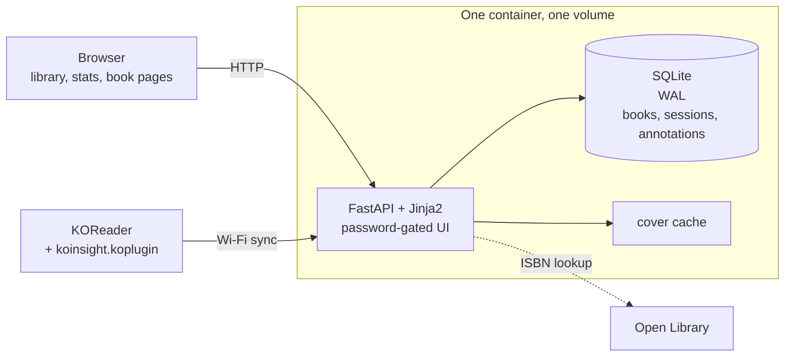

athenaeum is a small, self-hosted reading tracker. It does not store books or move them between devices. It keeps the record of reading them: time and pages read, streaks, highlights, notes and the verdict you write when you close a book.

## A tracker, not a library

That distinction matters because most tools in this space solve a larger problem. [KoInsight](https://github.com/Ko-Insight/KoInsight) is the obvious reference point: it is the project whose `koinsight.koplugin` athenaeum reuses, and it already turns KOReader statistics into a clean dashboard. It goes further in some directions too, acting as a KOReader progress-sync server and supporting multiple devices. But it is archived, and its README now points users to BookOrbit. athenaeum keeps the same core idea in a smaller package.

The other alternatives solve different problems. [Goodreads](https://www.goodreads.com) is a hosted social catalogue: it is good at discovery and public shelves, but progress is often entered by hand and the reading history lives in someone else's account. [Calibre's content server](https://calibre-ebook.com) and [Calibre-Web](https://github.com/janeczku/calibre-web) are library servers: they store, organise and deliver book files, which is more than is needed when the e-reader already holds the books. [BookOrbit](https://github.com/bookorbit/bookorbit) is the most complete self-hosted platform, with multi-user accounts, metadata providers, companion apps and integrations.

athenaeum deliberately stays on the smaller side of that line. One reader, one container, one SQLite file. It is not where the EPUBs live; it is where the reading evidence lives. It is small enough to run on a home server, a NAS or a Raspberry Pi alongside other services, not to become another service to administer.

<figure class="writeup-video writeup-video-pair">
  <video
    class="writeup-video-desktop"
    src="/videos/athenaeum-demo.mp4"
    poster="/videos/athenaeum-demo-poster.jpg"
    autoplay
    loop
    muted
    controls
    playsinline
    preload="metadata"
    aria-label="Walkthrough of athenaeum: filtering the library by label, the shelf view, a book with reading speed and time left, its highlights, the to-read list, label management, reading statistics and the calendar"
  ></video>
  <video
    class="writeup-video-mobile"
    src="/videos/athenaeum-demo-mobile.mp4"
    poster="/videos/athenaeum-demo-mobile-poster.jpg"
    autoplay
    loop
    muted
    controls
    playsinline
    preload="metadata"
    aria-label="The library, a book with reading speed and time left, its highlights, the to-read list and the stats page at phone width, in dark mode"
  ></video>
</figure>

## Syncing from KOReader

The main input is KOReader. The hard part is already solved by the KoInsight project: its `koinsight.koplugin` runs inside KOReader and builds the payload. athenaeum implements the server side, so the plugin can stay unmodified and the credit for the device-side work stays with KoInsight.

Over Wi-Fi, the plugin sends books, reading sessions, highlights, notes and bookmarks. The payload is keyed by MD5, so re-syncing updates the existing row instead of creating a duplicate. Sessions are upserted on `(book_id, page, start_time)`, annotations on `(book_id, datetime, page_ref)`, and the daily tables are rebuilt from the sessions after each import. The sync is idempotent: running it twice leaves the same archive.

There is also a manual path. A book can be added by hand, with an optional ISBN lookup for title, author and page count from Open Library. That covers paper books and books read before the e-reader, so the archive is not limited to what KOReader happened to track. The book page also lets you set a rating, write a review and mark the book as read; highlights and notes can be added or edited by hand as well.

## Architecture

athenaeum is a single FastAPI process serving Jinja2 templates and a SQLite database. There is no separate frontend build, no external database, no queue and no object store. The browser gets server-rendered pages and a little vanilla JavaScript for search, filtering and the shelf view.

Raw events and derived views are separate. Books and sessions are the source of truth; the daily tables are rebuilt from sessions, so a repeated import converges instead of accumulating. SQLite runs in WAL mode with a busy timeout, and the database and cover cache live on one volume. A backup endpoint uses `VACUUM INTO` to produce a consistent copy while the app is running.

The only external service is Open Library, for ISBN metadata and cover images. Covers are cached locally; a book without one gets a generated SVG jacket, so the library does not depend on a third party being available to look complete.

No social graph, no recommendation engine, no reading challenges and no subscription. Those are product features; this is an archive. The reader already has a device that counts pages and a brain that decides what matters. athenaeum keeps both records in one place.
