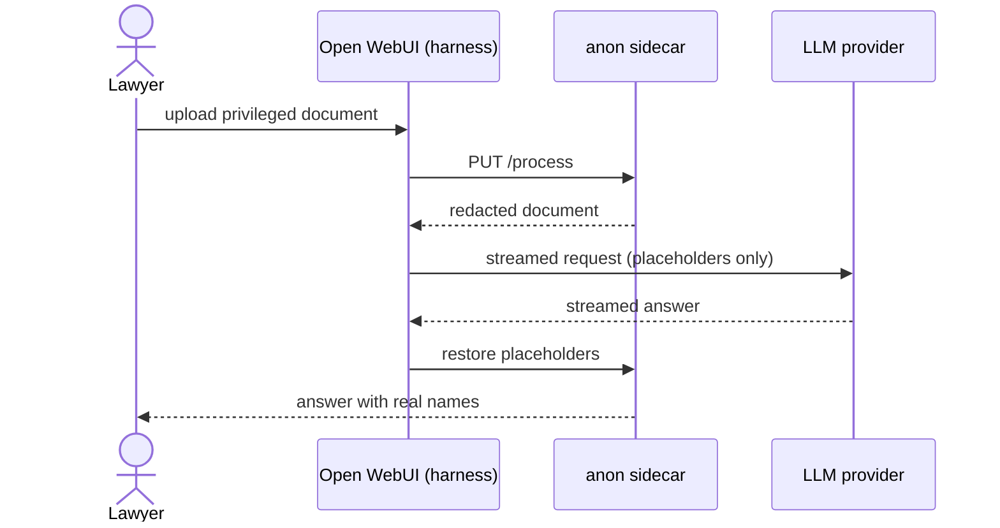
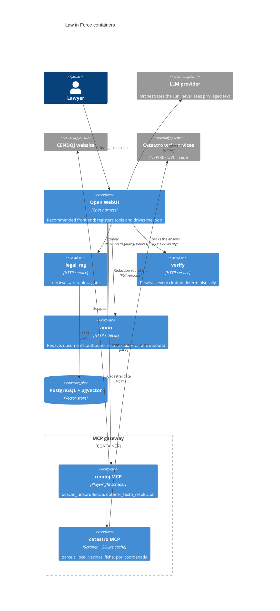

A general chat model is the wrong tool for a legal question. Publicly available LLM chatbots are trained over an outdated corpus and either rely on external tools like web search or fetch, sometimes leaning towards hallucinating an inaccurate response. For a law firm, the cost of being wrong is far too high to rely on probabilistic guesses or unverified sources when client outcomes demand verifiable, authoritative precedent.

Law in Force is an assistant built around that constraint. It relies on a series of tools that ground every response in real-time statutory databases and verified primary sources.

## Legal RAG

Retrieval-augmented generation is the practice of handing a model the material it needs to answer instead of trusting that the answer is already somewhere in its weights. A general model is trained once and frozen, so it goes stale, and it has no built-in way to show where a claim came from. Retrieval closes both gaps: before the model writes anything, the system fetches the passages that matter from a source it controls and puts them in front of it, so the answer is grounded in material that can be updated, cited and checked.

Legal RAG turns a legal question into the passages that should decide the answer. The corpus is Spanish and EU primary law ingested from BOE and EURLex and embedded into PostgreSQL with pgvector. A question first pulls a candidate set by vector similarity, then a rerank pass reorders it so the passages that actually address the question come to the top, and the service returns those sources to the LLM.

## Answering only from citable sources

A verification gate has been developed to double check the returning content from an LLM, which even under specific guidelines and sources can hallucinate. `verify` resolves the citations deterministically, which means a fabricated reference is caught by the same kind of code that would catch a broken link, not by a judge that can itself be talked out of a decision.

```mermaid Law in Force request lifecycle
swimlane-beta LR
  subgraph Lawyer
    ask[Legal question]
    read[Answer with sources]
  end
  subgraph Harness["Open WebUI (harness)"]
    fetch[retrieve → rerank]
    compose[Harness writes the answer]
  end
  subgraph legal_rag
    gate{Corpus covers it?}
    sources[Citable sources]
  end
  subgraph verify
    check{Citations resolve?}
    gap[Declared gap, nothing invented]
    withheld[Answer withheld]
  end
  ask --> fetch
  fetch --> gate
  gate -->|Yes| sources --> compose
  gate -->|No| gap
  compose --> check
  check -->|Yes| read
  check -->|No| withheld
```

## MCPs

Two MCP servers give the assistant the material that is not in the corpus. The first fronts CENDOJ, the Spanish case-law service: `buscar_jurisprudencia` runs a search over resolutions and `obtener_texto_resolucion` fetches the full text of a hit. This architectural decision comes from the stricter terms of use that CENDOJ has against scraping and massive downloading.

The second one fronts the cadastral registry. It exposes `parcela_local` for the plot at a location, `vecinas` for the neighbouring parcels, `ficha` for the official record and `por_coordenada` to resolve coordinates to a parcel, with `descargar_municipio` pulling a whole municipality at once. The public services it calls are slow and rate-limited, so the server keeps a SQLite cache on the firm's side: a plot requested once is answered from `/data` the next time instead of being fetched again.

## Keeping documents inside the firm

Law in Force is built for Spanish law firms, which already have to comply with the GDPR and the EU AI Act when they handle client material. The anonymisation here is not a substitute for that compliance, it is an extra layer on top of it. Even when a firm is allowed to send material to a provider under its own agreements, the assistant removes the client names before the request leaves and restores them once the answer comes back, so the protection does not depend on the provider's terms.



## Why OpenWebUI?

The assistant needs a chat front end that can run an agent loop, register tools, accept document uploads and stream the answer back. Open WebUI is the perfect fit for being an open-source harness friendlier than other CLI alternatives.

Configuring the provider is a base URL and a key; adding a capability is registering a tool, so the engineering effort goes into the legal stack instead of into chat infrastructure. It also puts the redaction round trip in the right place. The upload arrives at the harness, which hands it to the anon sidecar before anything is sent to the provider, and restores the placeholders once the answer streams back. Because that happens in the request lifecycle rather than in the prompt, the model never receives a document it could later be persuaded to repeat. The native tools and the MCP servers register through the same interface, so every legal capability hangs off one integration point.

## The whole thing

Seen at container level, the assistant is a few self-hosted services around a chat
harness. The provider supplies the model and the harness executes the run, but the
corpus, the vector store, the cache and the scrapers stay on the firm's side, and only
redacted text crosses to the provider.


