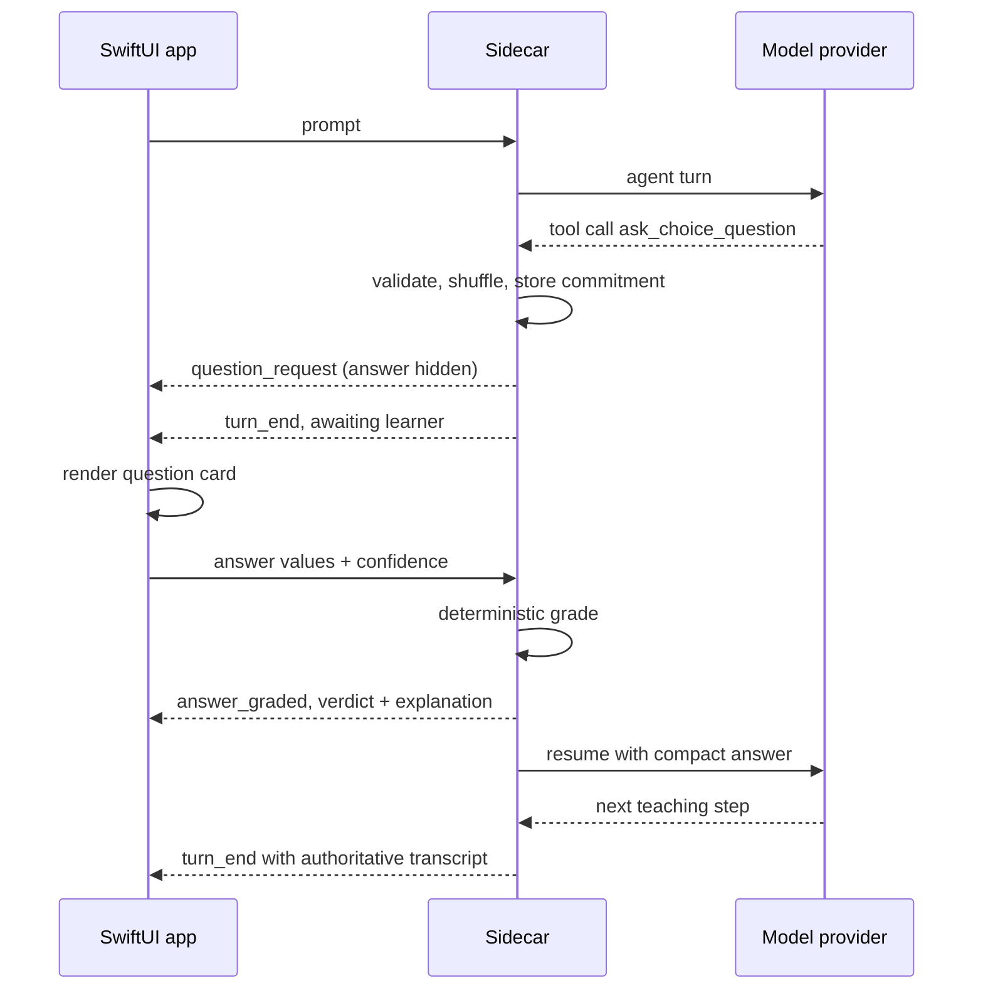
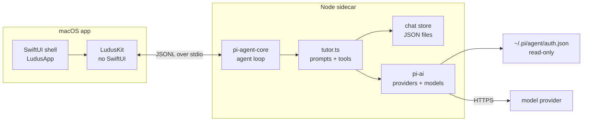

Ludus is a native macOS app for teaching yourself something. Not a chat window that happens to know about a topic: a small tutor that tries to work out what you already understand, writes down a path to where you want to go, and asks for evidence before the lesson moves on.

It exists because the hardest part of learning alone is not finding an explanation. Explanations are cheap. The hard part is knowing which explanation you need, whether it landed, and what to do when it did not. Under the hood it uses a coding harness for learning, which lets the model do more than dump prose and theory: it can quiz and test you too, and that makes the lesson more efficient. A general model will keep producing plausible prose. A tutor has to keep track of the learner.

## The loop

Ludus is built around a loop: probe, plan, teach. The probe is not a quiz for its own sake. It locates your frontier, with a floor and a ceiling for each strand, so the plan starts from evidence rather than from the topic name. The probe ends with a structured assessment, not a paragraph of encouragement: here is the goal, here is what you already have, here is where you fall short, and here is what to build from.

The loop started from the ideas in amosblomqvist’s [learn](https://github.com/amosblomqvist/learn) repository. After seeing [LearnHarness](https://github.com/amosblomqvist/learnharness), his official app implementation, I decided to build my own alternative instead: I did not want to rebuild a six-runtime web stack with 28 HTTP routes, two composition roots, SSE and a hexagonal core for a single-user desktop tool; I wanted to reuse the pi credentials and model catalog I already had instead of asking for another API key; I did not think a cross-session knowledge graph was worth its extraction bill; I wanted grading to live in the sidecar rather than in the browser; I preferred a schema-validated JSON plan to a Mermaid subset; and I wanted fewer surfaces and a native app that actually feels native. Ludus is one sidecar, one JSONL protocol, one SwiftUI shell, under 9,000 lines including tests, with a 1 MB release bundle and roughly 183 ms sidecar startup. I ported the loop’s ideas — probe with floor and ceiling, `probe_done`, an author-once plan, derived current/visited/upcoming, predict → teach → check, commit-before-pose, repair before advancing — not its AGPL-3.0 prompts or code, and I kept the scope to phases 0–2 until the loop proves useful in daily use.

The plan is authored once as a dependency graph. Each edge means “this must be understood before that”, and the graph is validated as a DAG before it is accepted. Progress is not a checkbox. Current, visited and upcoming nodes are derived from the questions that carry a `nodeId`, so the lesson can move without the model declaring victory. A failure keeps you on the same node until the step is repaired.

Teaching then follows the same unit: predict, teach, check. You predict before the explanation, so the explanation has something to correct. You read one reasoning step, not three restatements of it. Then a check gates the next step. The check is not decoration at the end of a chapter; it is the thing that decides whether there is a next chapter.

The central rule is commit-before-pose. Before you see a question, the model writes the correct answer and the explanation. Multiple choice is then graded against that commitment in code; for a free response, the commitment is immutable and the model judges your words against the answer it wrote earlier. The question cannot be rewritten after the fact to make your answer look better. That one constraint does more for honesty than any amount of prompt-level insistence on not being sycophantic.

## One app, one sidecar

Ludus is split into a native shell and a sidecar. The shell is SwiftUI: sidebar, streaming transcript, question card, plan panel, searchable model picker and a no-providers state. Under it sits `LudusKit`, a UI-free core containing the transcript models, plan tree, provider and model types, JSONL client, sidecar process wrapper and the turn reducer. It has no SwiftUI dependency and no ambient state; every mutation goes through `TutorState.apply`.

The sidecar is TypeScript. It runs `@earendil-works/pi-agent-core` for the agent loop and `@earendil-works/pi-ai` for providers and models, and it owns the prompts, tools, persistence, provider auth and model catalog. The app does not reimplement any of that. It sends commands, receives events and renders the state those events describe.

The split puts each part where it is strongest. Swift handles the native window, keyboard handling and a transcript that streams smoothly. The Pi ecosystem handles the agent loop, tool calling and provider differences. The sidecar is the authority for everything that must not be guessed twice: prompts, persistence, credentials, the model catalog and the verdict on an answer. `turn_end` carries the transcript the app should display, so the UI is a view of state rather than a second source of truth.
