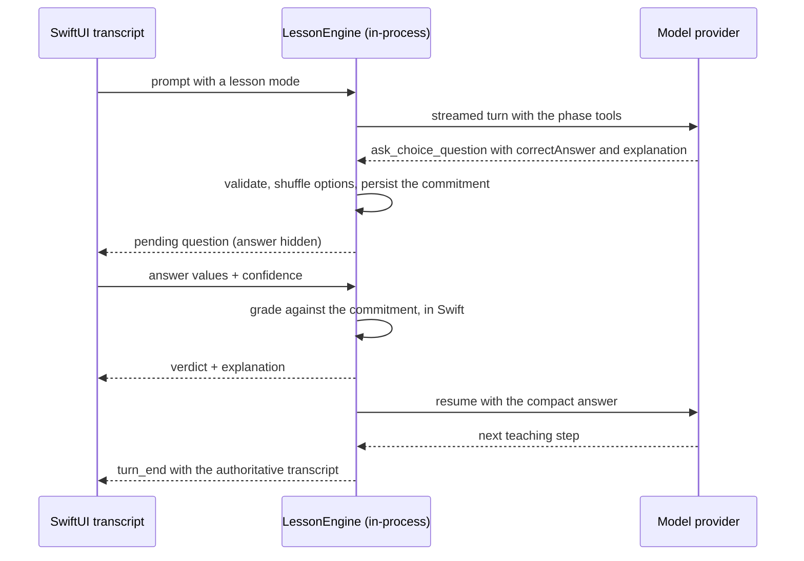
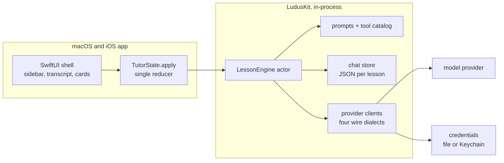

Ludus is a native tutor for macOS, iPhone and iPad. Ask for a topic and it probes what you already know, writes a plan for the gap between that and your goal, and teaches one step at a time. No concept counts as understood until a check confirms it. Free for download at [ludusapp.pages.dev](https://ludusapp.pages.dev).

It exists because general AI chatbots are excellent at answering questions and following topics but learning involves both the tutor and the user taking part on the process. A general model will keep producing plausible prose; a tutor has to keep track of the learner. Ludus acts as a lightweight bridge that makes third party models understand the necessities of the learner.

## The idea

The idea behind this project comes from amosblomqvist’s [learn](https://github.com/amosblomqvist/learn) repository which developed the concept of learning harness. After testing [LearnHarness](https://github.com/amosblomqvist/learnharness), his official app implementation, I decided to build my own alternative instead. The main reasons were:

- **App size and UI/UX:** LearnHarness is built on Electron. That gives it cross-platform support, but it feels slow and uses a lot of disk space and RAM. I was also not a fan of its look and feel.
- **Credentials:** I wanted to reuse my existing setup and not having to set up a new api key. Ludus allows to import credentials from the pi coding harness at first boot whilst keeping the option for manual setup.
- **Token cost and additional features:** LearnHarness implements a memory system that builds graphs and keeps sessions updated on what the user already knows. For many people that is a great feature, but the token cost it adds was not worth it to me.

The prompts used for the loop steps were rewritten from scratch to comply with LearnHarness’s AGPL-3.0 license. The model catalog is generated from `@earendil-works/pi-ai` so we don't have to manage this and can focus on improving the app itself.

## The loop

A lesson starts in one of three modes. **Full loop** probes first, then plans. **Skip probe** plans straight from the user's topic. **Quick learn** answers like a plain assistant: no probe, no plan, no checks.

The probe is not a quiz for its own sake. It simulates an interview of free-response questions that locates your frontier per strand: the lines of knowledge the goal actually needs. For each strand the tutor has to find a floor and a ceiling: what you demonstrably have, and the most specific thing you get wrong or cannot yet do. A correct answer raises the ceiling hard, a shallow one raises it gently, a wrong one lowers it and narrows the next question. The probe ends with a structured assessment, not a paragraph of encouragement: here is the goal, here is what you already have, here is where you fall short, and here is what to build from. The budget is at most eight questions, usually three to five, and it stops the moment every strand is bracketed by evidence.

The plan is authored once as a dependency graph. Each edge means “this must be understood before that”. Current, visited and upcoming nodes are derived from the questions that carry a `nodeId`, so the lesson can move without the model declaring victory. A failure keeps you on the same node until the step is repaired, and a node the learner already holds can be removed, with its prerequisites bridged to its dependents so the graph still describes the same path.

Teaching follows the same unit: predict, teach, check. You predict before the explanation, so the explanation has something to correct. You read one reasoning step, not three restatements of it. Then a check gates the next step. Passing is not enough on its own: a correct answer given with low confidence leaves the node open, because recognising an answer is not the same as holding it. The check is not decoration at the end of a chapter; it is the thing that decides whether there is a next chapter.

The central rule is commit-before-pose. Before you see a question, the model thinks internally the correct answer and the explanation. Multiple choice, ordering and matching questions are then graded against that commitment in code, with the options shuffled so position carries no information. For a free response the commitment is fixed in the tool call that asked the question, and the model judges your words against it afterwards; once assessed, an answer cannot be reassessed. The question cannot be rewritten after the fact to make your answer look better. That one constraint does more for honesty than any amount of prompt-level insistence on not being sycophantic.

## One app, one engine

Ludus is one SwiftUI tree with a UI-free core under it. `LudusKit` holds the transcript models, the plan tree, the prompt resources, the tools, the chat store and the provider clients. It has no SwiftUI dependency and no ambient state; the UI never edits a lesson, it applies events through `TutorState.apply`.

The seam between the two is a pair of enums. `EngineCommand` goes in — prompt, answer, approve plan, edit plan, set model, reload — and `EngineEvent` comes out: streamed deltas, pending questions, graded answers, plan updates, turn end, errors. `LessonEngine` is an actor, so a turn cannot interleave with another turn in the same lesson, and the UI stays a view of state rather than a second source of truth. `turn_end` carries the transcript the app should display, which means the app never reconstructs a lesson from its own guesses.

The split puts each part where it is strongest. Swift handles the native window, keyboard handling, dictation and a transcript that streams smoothly. `LudusKit` handles the parts that must not be guessed twice: prompts, persistence, credentials, the model catalog and the verdict on an answer. Persistence is one JSON file per lesson plus an index that caches title, stage and counts, so the sidebar does not decode every transcript at launch. Assistant replies are checkpointed while they stream, which matters on iOS: a background suspension or an abort keeps the partial reply on disk instead of losing the turn.

Providers are one protocol with four implementations — OpenAI completions, OpenAI responses, Anthropic messages and Google generative AI. Each adapter turns its own stream into the same turn shape, so the engine never learns a provider’s wire format. The model catalog is a generated snapshot bundled with the app, refreshed by a one-shot tool when the `pi-ai` pin moves; CI fails if the committed snapshot is stale, so the picker cannot drift from the providers it claims to support. Credentials live in the app’s own store, a file on the Mac and the Keychain on iOS, with an optional read-only import of `~/.pi/agent/auth.json` for people who already keep keys there.

## Visuals the model can run

A sentence is a poor carrier for a family of curves, a filter response or a timing diagram, so the teaching stage has a `show_html` tool: the model writes a self-contained HTML document, and the app renders it in a sandboxed web view inside the transcript. The site’s interactive examples are the same idea, running in a page.

The card, not the model, owns the viewport. Before the document is displayed it gets a content security policy of `default-src 'none'` with inline scripts and styles only, so a visual has no network surface at all: no external images, fonts, scripts, `fetch`, sockets or iframes. The app injects the theme, the text scale and the viewport metadata, and strips any viewport tag the model wrote, so the same document stays legible in light, dark, Mac and phone layouts. Validation rejects the things that break a small screen: `100vh`, `position: fixed`, horizontal scrolling, fixed widths over 480 points, documents over 48 KB.

Two details make it feel less like an embedded page and more like part of the lesson. While the model is still writing the document, the app reads the half-written tool arguments and shows a card of the right title and height, so there is a placeholder instead of a gap. And a visual that fails to run is not a dead end: the error goes back to the model as one repair turn with the failure text, and a visual that renders taller than its card is clipped with a warning rather than left broken. The tool is not a rendering primitive; it is a small contract with the model about what will stay inside the frame.

## Sync between devices, no third party server

The iPhone app is built from the same sources as the Mac app, and the two can reconcile lessons without an account. Pairing happens once: both screens show a six-digit code, an X25519 exchange derives a key that never leaves the two Keychains, and the channel is Bonjour on the local network with `ChaChaPoly` frames. The merge keeps the common prefix of a lesson and reconciles the diverged tail by message identity and timestamp, with ties broken by content rather than by which side is asking, so both devices converge on the same record. Nothing is uploaded, there is no sync service to run, and the feature is optional: a single device never needs it.

What the architecture buys is not elegance for its own sake. Grading happens in code, plan progress is derived from tagged questions, and a commitment cannot be rewritten after the question is posed. Those three constraints are what let the app say “not yet” to an answer that sounds right, which is the only way a tutor is worth trusting.
