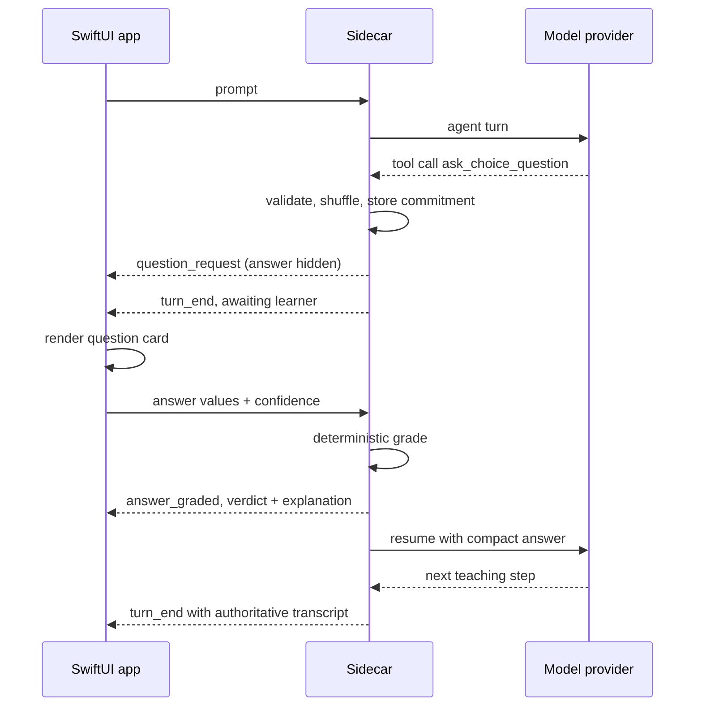
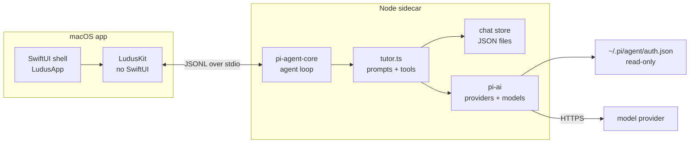

Ludus is a native macOS app for teaching yourself something. Not a chat window that happens to know about a topic: a small tutor that tries to work out what you already understand, writes down a path to where you want to go, and asks for evidence before the lesson moves on.

It exists because the hardest part of learning alone is not finding an explanation. Explanations are cheap. The hard part is knowing which explanation you need, whether it landed, and what to do when it did not. A general model will keep producing plausible prose. A tutor has to keep track of the learner.

## The loop

Ludus is built around a loop: probe, plan, teach. The probe is not a quiz for its own sake. It locates your frontier, with a floor and a ceiling for each strand, so the plan starts from evidence rather than from the topic name. The probe ends with a structured assessment, not a paragraph of encouragement: here is the goal, here is what you already have, here is where you fall short, and here is what to build from.

The plan is authored once as a dependency graph. Each edge means “this must be understood before that”, and the graph is validated as a DAG before it is accepted. Progress is not a checkbox. Current, visited and upcoming nodes are derived from the questions that carry a `nodeId`, so the lesson can move without the model declaring victory. A failure keeps you on the same node until the step is repaired.

Teaching then follows the same unit: predict, teach, check. You predict before the explanation, so the explanation has something to correct. You read one reasoning step, not three restatements of it. Then a check gates the next step. The check is not decoration at the end of a chapter; it is the thing that decides whether there is a next chapter.

The central rule is commit-before-pose. Before you see a question, the model writes the correct answer and the explanation. Multiple choice is then graded against that commitment in code; for a free response, the commitment is immutable and the model judges your words against the answer it wrote earlier. The question cannot be rewritten after the fact to make your answer look better. That one constraint does more for honesty than any amount of prompt-level insistence on not being sycophantic.

## One app, one sidecar

Ludus is split into a native shell and a sidecar. The shell is SwiftUI: sidebar, streaming transcript, question card, plan panel, searchable model picker and a no-providers state. Under it sits `LudusKit`, a UI-free core containing the transcript models, plan tree, provider and model types, JSONL client, sidecar process wrapper and the turn reducer. It has no SwiftUI dependency and no ambient state; every mutation goes through `TutorState.apply`.

The sidecar is TypeScript. It runs `@earendil-works/pi-agent-core` for the agent loop and `@earendil-works/pi-ai` for providers and models, and it owns the prompts, tools, persistence, provider auth and model catalog. The app does not reimplement any of that. It sends commands, receives events and renders the state those events describe.

The split puts each part where it is strongest. Swift handles the native window, keyboard handling and a transcript that streams smoothly. The Pi ecosystem handles the agent loop, tool calling and provider differences. The sidecar is the authority for everything that must not be guessed twice: prompts, persistence, credentials, the model catalog and the verdict on an answer. `turn_end` carries the transcript the app should display, so the UI is a view of state rather than a second source of truth.

## Why I built my own

LearnHarness by amosblomqvist is the reference that convinced me the loop was worth building. It treats evidence as the thing that decides progress, it measures before it teaches, and it makes the plan a hypothesis about the learner rather than a syllabus. Ludus is my personal alternative to it, not a port. These are the decisions that led me to write a different app.

### A desktop tool does not need a web stack

LearnHarness carries six runtime systems, 28 HTTP routes, two composition roots, two barrels, an ESLint import-law plugin, SSE and a hexagonal core. That architecture solves coordination problems a local tutor app does not have. I refused to rebuild it for a single-user desktop tool. Ludus is one sidecar, one JSONL protocol, one SwiftUI shell, under 9,000 lines including tests. The smaller machine is not a compromise; it is the point.

### I wanted to use the setup I already had

I already had `~/.pi/agent/auth.json` and models configured. LearnHarness starts by asking for an API key. Ludus reads pi’s credentials in read-only mode, picks up the model catalog and opens with the providers I already use. It never writes to my pi config. Adding a provider is an operation on pi, not a second account setup inside the tutor.

### I do not believe a cross-session knowledge graph is worth its token bill

LearnHarness’s core bet is extracting propositions and reasoning chains from every session into append-only ledgers, then re-reading them in later sessions. I understand the appeal, but I want the cheapest possible loop. Keeping each lesson’s material inside its own chat is enough for me, and it avoids a background extraction pipeline whose cost grows with every session. Memory that has to be paid for on every lesson is not free memory; it is a second product.

### The sidecar should decide whether an answer is right

LearnHarness grades multiple-choice questions in the browser through `question-core`. In Ludus the sidecar grades them. There is one implementation, one source of verdicts, and the UI cannot drift from it. The Swift side renders the verdict it receives; it does not decide what correct means. That is especially important for a tutor, where a plausible-looking client-side check can quietly disagree with the contract the model was given.

### A plan is structured data, not a diagram format

LearnHarness parses a Mermaid subset and validates it as a DAG. Ludus uses a schema-validated JSON `plan_init` that Swift can consume directly. The plan is authored once and progress is derived from tagged questions, but there is no parser sitting in the middle between the model and the app. A parser is another surface that can fail, another syntax to teach the model, and another representation to keep in sync. JSON is the representation the app already needs.

### Fewer surfaces, fewer failure modes

There is no 30-provider picker, no subscription credential bridges, no OAuth, no 28-route API and no web worker model. Ludus supports API-key providers through pi and says so honestly. Everything it does, it does with three runtime dependencies. That is a deliberate limit, not a claim that the missing integrations are bad ideas. A personal desktop tutor should be small enough that I can understand the whole failure surface.

### Native has to feel native

Performance is a design constraint, not a later pass. I measured the app: a 1 MB release bundle and roughly 183 ms sidecar startup. I also removed the things that made it feel slow: per-token events, markdown re-parsed on every keystroke, transcript re-renders on every composer keystroke, and glass layers inside scrollable content. Native only matters if it actually feels native. A SwiftUI shell wrapped around a slow loop is still a slow app.

### I ported the loop, not the code

LearnHarness is AGPL-3.0, so copying its prompts or code would impose obligations. I took the ideas — probe with floor and ceiling, `probe_done`, an author-once plan, derived current/visited/upcoming, predict → teach → check, commit-before-pose, repair before advancing — and rewrote the prompts and mechanics from scratch. The architecture is different, the wording is different, and the implementation is different. What survives is the discipline of the loop.

### Sequence beats scope

Ludus implements phases 0–2: the question contract with deterministic grading, a real prober with a structured assessment, and a live plan with check gating. Phases 3–4, graph memory and practice sets, stay unbuilt until the loop I have is proven useful in daily use. LearnHarness shipped everything at once. I would rather earn each layer, because a tutor that does three things well is more useful to me than one that does six things before the first one has been tested.

## What Ludus is for

Ludus is not trying to be a platform, a classroom or a replacement for a teacher. It is a personal tool for the specific moment when you want to understand something and need more structure than a chat window gives you. The app should feel like a native Mac application. The lesson should feel like a lesson. The model should be allowed to teach, but not allowed to decide on its own that you understood.

The loop is the product. Everything else — the native shell, the sidecar, the JSONL boundary, the small dependency count — exists to make that loop cheap enough to run, honest enough to trust and fast enough to use every day.
