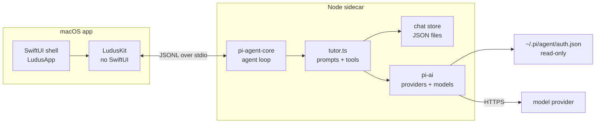
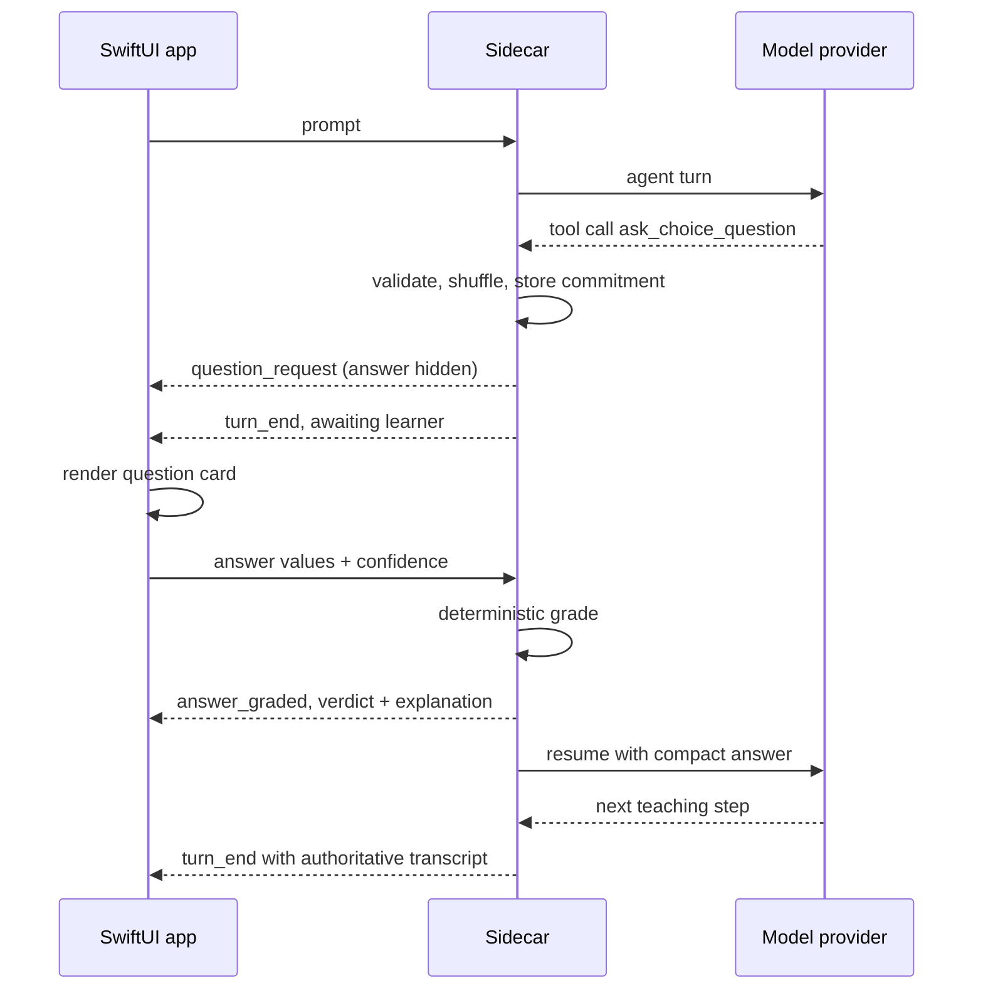

A general chat model is not a tutor. It can explain a topic, answer a question and sound like it knows what the learner needs next, but none of those behaviours requires knowing what the learner actually understands. A tutor does. It has to locate the frontier, decide what the next step is, teach that step, and then get evidence that the step landed before moving on. A chat model, left to itself, will accept “that makes sense” as evidence and continue.

Ludus is a native macOS tutor built around that difference. The window is a SwiftUI app, the teaching loop runs in a TypeScript sidecar on the Pi agent loop, and the two speak JSONL over stdio. It is not a chat wrapper with a tutor prompt. The question contract, the grading rules and the shape of the transcript are part of the system, and the interface is built to show a lesson rather than a conversation.

## A tutor is a diagnosis, not an answer

Using a chat model as a tutor fails structurally. It is optimised to produce the next plausible message, not a truthful model of what the learner can do. It will explain the same idea three ways, agree that it was clear, and move on without asking the learner to reconstruct anything. Fluency is not evidence; neither is “got it”.

Real tutoring has a loop with obligations. Diagnose what is already there. Write down a path to the goal, with dependencies rather than a list of topics. Teach one step at a time. Ask a question whose answer was decided before the question was shown. Mark the answer against that commitment. Repair the specific broken step before advancing. The learner can fail, but the lesson cannot silently skip the failure.

The model supplies judgement and language; the surrounding system supplies memory, constraints and a definition of progress that does not depend on the model’s optimism.

## Two processes, one contract

Ludus is split into a native shell and a sidecar. The shell is SwiftUI: sidebar, streaming transcript, question card, plan panel, searchable model picker, usage display and a no-providers state. Under it sits `LudusKit`, a UI-free core containing the transcript models, plan tree, provider and model types, JSONL client, sidecar process wrapper and the turn reducer. `LudusKit` has no SwiftUI dependency and no ambient state; every mutation goes through `TutorState.apply`.

The sidecar is TypeScript. It runs `@earendil-works/pi-agent-core` for the agent loop and `@earendil-works/pi-ai` for providers and models, and it owns prompts, tools, persistence, provider auth and the model catalog. The app does not reimplement any of that: it sends commands, receives events and renders the state those events describe.



It also keeps credentials out of the app. Ludus reads pi’s credentials read-only: API keys from `~/.pi/agent/auth.json`, model metadata from the built-in `pi-ai` catalog plus the cached `~/.pi/agent/models-store.json` overlay. Only `api_key` providers are shown; OAuth and custom `~/.pi/agent/models.json` providers are not supported yet. Ludus never writes to `auth.json`, so rotating a key stays an operation on pi’s credentials, not on a second copy inside the tutor.

A turn is a small protocol: the app sends commands, the sidecar emits events. A question is a tool call that ends the turn instead of holding a model connection open:

```json
{"type":"answer","chatId":"c_01","questionId":"q_call_1","values":["b"],"confidence":70}
{"type":"answer_graded","chatId":"c_01","questionId":"q_call_1","kind":"choice","correct":false,"correctValues":["c"],"explanation":"…"}
```

The sidecar validates the question, shuffles options deterministically from the tool-call id, stores the commitment, emits `question_request` without the answer, and tells the agent to stop. The learner answers later as a new command, not a continuation of an open stream.

## The learning loop

The intended loop is probe, plan, teach. The probe is not a quiz for its own sake: it locates the learner’s frontier so the plan is built from evidence instead of from the topic name. The plan is a dependency graph authored with `plan_init`, validated as a DAG, with each edge meaning “this must be understood before that”. Teaching then moves through the graph one reasoning step at a time. A failed check should repair the step, not restart the explanation louder.

The question layer is the part that is already implemented. Phase 0 of the loop is the question and grading contract:

- `ask_choice_question` takes 2–6 options, an explanation and a correct answer. Each option is a bare claim; the payload shown to the learner never hints at the right one.
- `ask_free_response_question` takes an open question and a full committed answer. The learner answers from scratch in the composer.
- Both tools reject malformed input back to the model instead of showing a broken question to the learner.
- Multiple-choice grading is deterministic and lives in the sidecar. The model does not decide whether the learner was right.
- Answers return as structured commands with values, text, optional confidence and an explicit “I don’t know”; the old “Answer/Reasoning/Confidence” string is gone.

That contract is the foundation, not the whole tutor. Phase 1 turns the single diagnostic question into a prober with bracketing and `probe_done`. Phase 2 adds `nodeId` and `predict`/`check` tags, derived plan statuses and the predict → teach → check cycle. Phase 3 adds persistent memory: propositions, reasoning chains and read-only tools. Phase 4 adds practice sets. These phases are planned, not shipped.

## Committing before posing

The most important rule in the implemented loop is commit-before-pose. Before the learner sees a question, the model writes the correct answer and explanation. Multiple choice is then graded against that commitment in code. For free response the commitment is immutable: the model judges the learner’s words against the answer it wrote earlier, not a target revised after seeing the response.

This matters because the obvious failure mode of an LLM tutor is sycophancy with good manners. If the model can decide correctness after reading the answer, a confident wrong answer can be talked into being “basically right”; if it can rewrite the intended answer, the lesson quietly changes to match whatever the learner said. Committing first removes both moves. The question card is the visible surface, but the real work happens in the sidecar.



The card itself is deliberately narrow. Multiple choice is selection, not a textarea: options, keyboard navigation, a confidence rail, and “I don’t know” as a first-class answer. Free response uses the normal composer. The model’s own thinking blocks render collapsed, so its reasoning can be inspected without becoming the lesson. A separate learner “thinking” field is in the design notes but deferred; the phase-0 decision was to keep choice as choice.

`turn_end` is the authority for state. Live `text_delta` events are decoration while the model talks. When the turn ends, the UI replaces its transcript, pending question, plan and usage from the event. That is why restarting mid-question is safe: the pending question is reconstructed from persisted tool details, including the shuffled order, not from a local view-model guess.

## The laws the boundary enforces

The README states five architectural laws, and they explain most of the codebase:

1. The sidecar owns persistence, credentials, the model catalog and provider I/O. Swift never reads API keys, constructs prompts or calls a model.
2. `turn_end` is authoritative. The UI replaces its transcript from the event; live deltas are decoration, not state.
3. The question card renders on `question_request`; answers are submitted only once the turn has ended. The sidecar queues early answers anyway.
4. Provider and model selection travel as `{provider, modelId}`. Model IDs containing `/` are never parsed from display strings.
5. `LudusKit` has no SwiftUI dependency and no ambient state; every mutation goes through `TutorState.apply`.

The fourth law is less cosmetic than it sounds. Provider model ids frequently contain slashes, so a display string such as `opencode-go/anthropic/claude-sonnet-4` cannot be split reliably into provider and model. Ludus stores the pair per chat and passes it through the protocol as data. Defaults resolve from `LUDUS_PROVIDER` and `LUDUS_MODEL`, then the first model of the requested provider, then the first configured provider in `auth.json`; the UI never infers identity from a label. The same tolerant reading keeps old chats loadable: `derivePending` accepts the earlier `quiz`/`probe`/`recall` kinds and options stored as plain strings.

## What is built, and what is not

The honest description is a working shell and a working grading contract, not a finished tutor. Working today: sidebar persistence, streaming transcript, markdown and code rendering, collapsible thinking, the glass question card, per-chat model selection, the searchable model picker, the plan panel with derived levels, restart-safe resume, usage display, catalog warnings and the no-providers state. `plan_init` validates the graph as a DAG and rejects cycles, unknown edges, duplicate ids and too few or too many nodes. A smoke harness exercises the catalog and the full probe → answer → plan → turn-end flow.

Missing on purpose: math rendering, knowledge graph, practice sets, settings and onboarding UI, a bundled sidecar, OAuth, custom `models.json` providers, and automated UI or end-to-end coverage. Some are phase 3 and 4 work; some are undecided product questions. The app still uses `ObservableObject`/`@Published` rather than newer observation APIs. The README lists these gaps next to the working features.

The current probe is a single free-response question followed by `plan_init`, not the full bracketing prober. The plan panel lays out the graph but does not derive current, visited and upcoming states from question tags, and checks are not collapsed behind a reveal. The question contract is real; the pedagogical loop around it is partly still a design.

## What came from LearnHarness

LearnHarness is the reference that shaped the loop: measure before teaching, represent strands with a floor and a ceiling, bracket with questions instead of walking through basics, teach one reasoning step per message, and let evidence decide whether the learner advances. Its plan is a hypothesis about the learner, rewritten when evidence contradicts it; progress is derived from tagged questions rather than a “mark done” button.

Ludus ports those ideas and mechanics, not LearnHarness files. LearnHarness is AGPL-3.0, and copying its prompt text or code into a distributed app can impose obligations. The prompts here are rewritten in Ludus’s voice and examples; the mechanics that survive can be expressed as validation, tagging and deterministic grading in the sidecar. Ideas travel, implementation does not.

## The loop is the product

A model can always produce another explanation. The useful question is whether the system knows what the learner has demonstrated, what it may teach next, and what would count as evidence that the step landed. Ludus makes those questions structural: a native app for the lesson, a sidecar for authority, a committed answer before every question, and a transcript replaced by the server’s version of events rather than the UI’s hopes.

The first phase is the contract that makes the rest possible. The remaining phases are the tutor around it.
