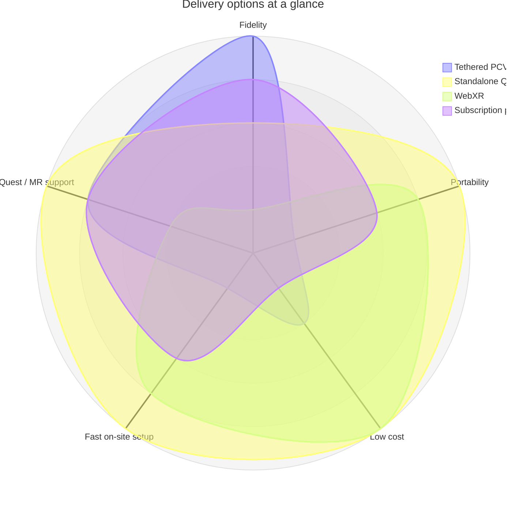

Buying a pool is not an easy decision as it requires a big investment. The usual tools available to the clients are an architect's render, a materials catalogue or a salesperson's imagination.

VR Pool Visualiser puts the pool in the customer's actual garden. On a Meta Quest 3 the app runs in passthrough, so the pool is composited into the real lawn and the customer walks around it and stands at the waterline before any concrete is poured. They can move it, reshape it, fill it with water, and change the finish, coping and model on the spot.

## Why Unity

The most important architectural decision is how will the app be developed. Based on the current options for development on Meta Quest 3 virtual headset, the two ends of that choice come down to choosing between tethered and untethered, and they trade very different things.

A tethered setup renders on a desktop GPU and streams the result to the headset, usually over a cable or a Wi-Fi link. It gives the app the most headroom by far: real-time lighting, reflections and post-processing that a mobile chip cannot afford, and a headset that stays light and cool because it is only showing someone else's pixels. The price is everything around the render. There is a PC to own and carry, a powerful and dedicated GPU, a link that can drop or stutter at the worst moment, and a setup that has to be assembled in a customer's garden.

An untethered headset removes all of that. The Quest 3 renders the scene itself, so the demo is a single device the salesperson carries, and the customer puts it on and is standing in their own garden seconds later, walking the pool at full room scale. Nothing depends on a link, and the illusion survives the customer turning around. The cost is a mobile chip that shares its power and thermal budget with the display and the tracking, so fidelity has to be earned rather than spent.

The tooling splits along the same lines. Free options come down to Unity's personal tier, Unreal's royalty model, Godot, or a WebXR library in the browser. Paid and subscription options generally involve an already made application that renders given models and materials under an expensive subscription. Not only the costs from this have to be considered but also the potential discontinuation such as it happened with SketchUp Pro, and the limited features they bring apart from visualising the model and changing a material. The chart below is a qualitative comparison rather than a benchmark; the shape of each profile is the point.

Unity is the choice because it sits where those trade-offs meet. It builds a native standalone app for the Quest which will remain working indefinitely, and it has first-class support for the Meta XR features the app leans on: passthrough compositing, hand and controller tracking, and a render pipeline that keeps the frame budget honest. Unreal would be a viable alternative but Unity's stability and approachable C# architecture make scaling development far more manageable; WebXR cannot carry the passthrough fidelity and stability a garden demo needs; Godot's mixed-reality support on the Quest is thinner than its desktop story.

## Approaching realism

The app has to convince someone that a pool is standing in their lawn while running on a headset with the compute budget of a phone and at the same time represent finishes as close to reality as possible. Most of what makes a desktop render photoreal is simply not available, so the realism comes from choosing what to render live and what to prepare in advance.

The expensive work happens offline. Lighting and the finish textures are authored and baked before the app ever runs, then mipmapped and anisotropically filtered so a mosaic stays crisp seen at a grazing angle instead of shimmering as the customer walks past. The water and the interior sample the same prepared maps, so the pattern lines up across the waterline and the pool reads as one tiled shell rather than a surface with water laid on top. Geometry is kept simple and the scene is built to hold a stable frame rate, because a dropped frame in VR is not a small visual flaw it is a comfort problem, and comfort outranks detail.

